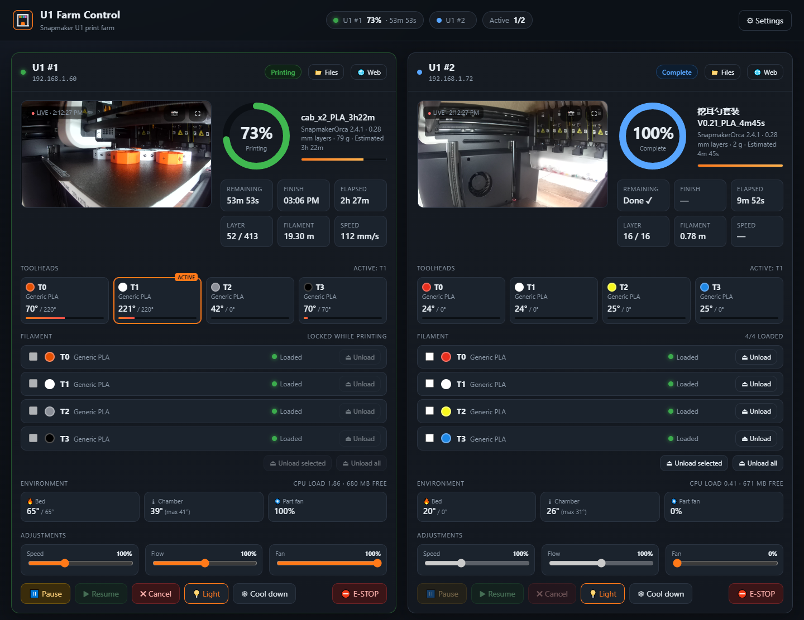
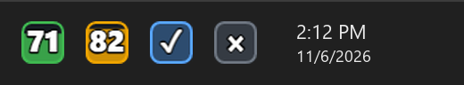

# U1 Farm Control: Snapmaker U1 print farm dashboard for Windows

**U1 Farm Control** is a free, open-source Windows app for monitoring and controlling
**Snapmaker U1** 3D printers. Watch one Snapmaker U1 or a whole print farm on one screen: live
camera, print progress, all four toolheads, filament unload and print controls. When you minimize
it, each Snapmaker U1 stays in the system tray next to the clock as an icon that shows its live
print percentage.

**Website:** https://g4zi.github.io/u1-farm-control/ · **Download:** [latest release](https://github.com/g4zi/u1-farm-control/releases/latest)



Available in **English, Türkçe, Deutsch, Español and Français**. The app follows your Windows
language by default; you can change it in Settings.

## Snapmaker U1 monitoring features

- **Tray icons with live progress.** Each Snapmaker U1 gets its own icon next to the clock. The icon
  shows the print percentage and fills up as the print progresses. Its color shows the state:
  green while printing, orange when paused, blue ✓ when finished, red on error and gray when offline.
  Hover over it to see the remaining time and file name.

  

- **Snapmaker U1 camera view.** On stock firmware the U1's built-in camera does not stream by
  itself. The app wakes it up automatically and shows the feed at about 1 frame per second.
- **Print details.** Progress, time remaining, estimated finish time, current layer, filament used,
  live speed and the slicer thumbnail.
- **All 4 toolheads of the U1 toolchanger.** Filament color and type, nozzle temperature, and
  which head is active.
- **Remote filament unload.** Unload one head, the heads you select, or all of them. The app uses
  the Snapmaker U1's own unload sequence.
- **Controls.** Pause, resume, cancel, chamber light, speed, flow and fan sliders, temperatures,
  turning off the heaters, and emergency stop.
- **Files and history.** Start a print from the G-code files on the printer and browse past jobs.
- **Notifications.** Alerts when a print finishes, pauses, fails, or a printer goes offline.
- **Start with Windows**, hidden in the tray (optional).

## Download and install

Download the latest version from the [Releases](https://github.com/g4zi/u1-farm-control/releases) page:

- `U1-Farm-Control-Setup-x.y.z.exe`: installer
- `U1-Farm-Control-Portable-x.y.z.exe`: a single file that runs without installing

On first launch the **Settings** window opens. Enter the local IP address of each Snapmaker U1. You can
find it in the printer's network settings on the touchscreen, or in your router's list of
connected devices.

> The executables are not code-signed, so Windows SmartScreen may show a warning.
> Click **More info → Run anyway**.

### Requirements

- Windows 10 or 11 (x64)
- One or more Snapmaker U1 printers. Tested with stock Snapmaker U1 firmware `2.0.0.205`;
  no custom firmware is needed.
- The PC and the printers must be on the same local network. The Snapmaker U1 runs Klipper with
  Moonraker; the app talks to each printer directly over the Moonraker API on port `7125`.
  No cloud service or Snapmaker account is needed.

## Running from source

Requires [Node.js](https://nodejs.org/) 20 or newer.

```bash
git clone https://github.com/g4zi/u1-farm-control.git
cd u1-farm-control
npm install
npm start
```

To build the Windows installer and the portable exe:

```bash
npm run dist
```

The files are written to `dist/`. When you push a tag such as `v1.2.3`, GitHub Actions builds
the installers and publishes them as a new release.

## How it works with the Snapmaker U1

| What | How |
|---|---|
| Status | Polls `GET /printer/objects/query` on Moonraker every 2 seconds |
| Camera | Sends `camera.start_monitor` (`{"domain":"lan"}`) over the Moonraker websocket every 8 seconds, then reads frames from `/server/files/camera/monitor.jpg` |
| Filament unload | `AUTO_FEEDING_BATCH` with `AUTO_FEEDING EXTRUDER=n UNLOAD=1 STAGE=prepare/doing`, the same sequence the touchscreen uses |
| Tray icon | Drawn on a canvas in the renderer and passed to the Electron `Tray` |

Project layout:

```
main.js            Electron main process: polling, tray icons, notifications, printer commands
preload.js         Bridge between the UI and the main process
renderer/          Dashboard UI (plain HTML, CSS and JS, no framework)
assets/            App icon
```

Settings are stored in `%APPDATA%\U1 Farm Control\config.json`.

## Contributing

Issues and pull requests are welcome. Ideas that would help most:

- More translations. All UI text is in [`renderer/i18n.js`](renderer/i18n.js): copy the `en` block,
  translate the values and add the language to `LANGS`.
- macOS and Linux builds (the code is cross-platform Electron; only the builds are missing)
- Testing with other firmware versions

## Disclaimer

This is a community project for Snapmaker U1 owners. It is not affiliated with or endorsed by
Snapmaker. Snapmaker and U1 are trademarks of their respective owner. The commands it
sends were read from the stock firmware, and a firmware update may change how they behave. Actions
such as filament unload and emergency stop physically move your printer. Use at your own risk.

## License

[MIT](LICENSE)
